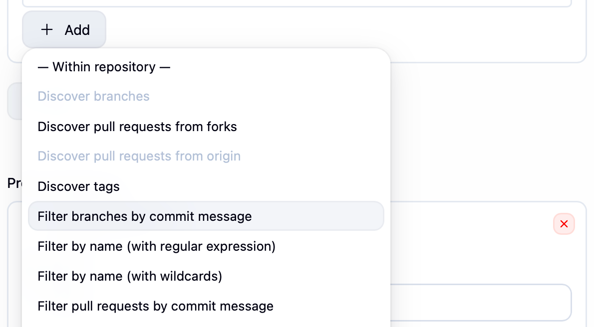
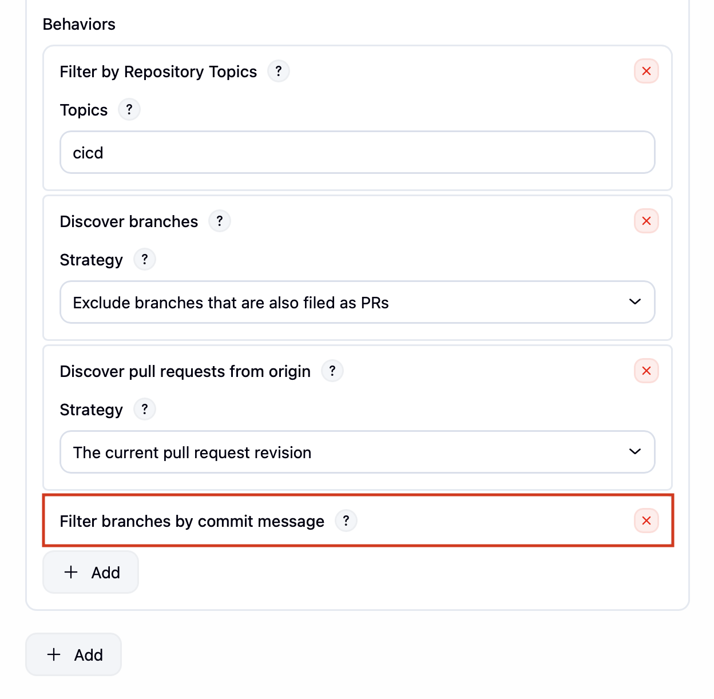

# Bitbucket SCM Trait Commit Skip

## Description

This plugin extends the filtering abilities of the
[Bitbucket Branch Source](https://github.com/jenkinsci/bitbucket-branch-source-plugin).

This filter will ignore events where the last commit of the source branch 
contains the tags `[skip ci]` or `[ci skip]`. It provides a similar
functionality as [Circle CI does](https://circleci.com/docs/guides/orchestrate/skip-build/).

The filtering is only performed for change request events, so push
events to non-pull requests will be always run.

## Warning!

The current implementation works by "tagging" the relevant pull
request job as excluded. As a result the job will be disabled (won't be
executable via the UI) and might get erased if an Orphaned Child policy
is applied, losing the whole PR build history.

## Usage

Two options are provided by this plugin:

* **Filter branches by commit message**
* **Filter pull requests by commit message**

When configuring a Bitbucket Team/Project, include an additional
behaviour (listed under "Within Repository"). 

 

This behaviour is not configurable. It will just show the behaviour listing and a simple inline
help icon:

